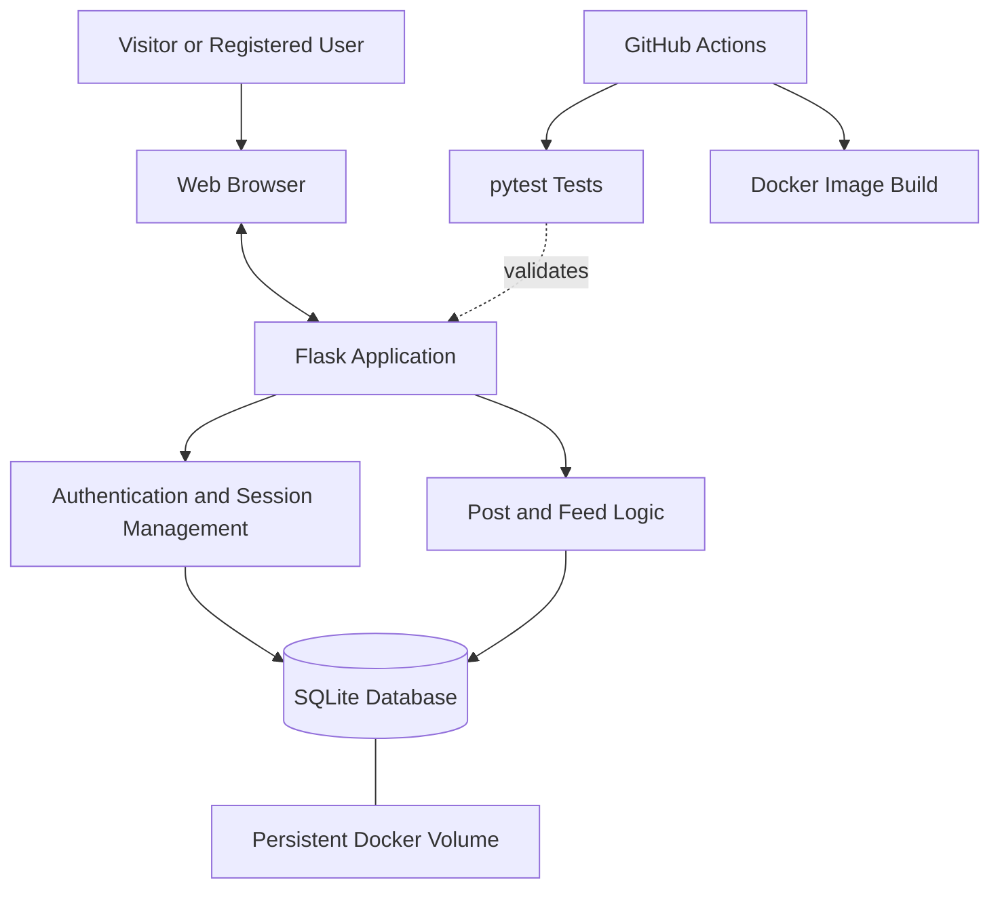

# System Architecture

## 1. Overview

The Social Media MVP will be implemented as a lightweight web application that allows users to register, log in, publish text posts, and view a public feed.

The application will use a monolithic architecture. This approach keeps the system simple to develop, test, deploy, and maintain within the scope of the Software Engineering Workshop project.

The architecture described in this document is the initial design and may be refined as development progresses.

## 2. Technology Stack

| Component | Technology | Purpose |
|---|---|---|
| Programming language | Python | Application logic |
| Web framework | Flask | HTTP routes and request handling |
| Frontend | HTML, CSS, Bootstrap | User interface and responsive layout |
| Database | SQLite | Persistent storage of users and posts |
| Password security | Werkzeug password hashing | Secure password storage and verification |
| Testing | pytest | Automated tests |
| Containerization | Docker and Docker Compose | Consistent application execution |
| Continuous integration | GitHub Actions | Automated validation of changes |
| Project management | GitHub Issues and Projects | Backlog and work tracking |

## 3. High-Level Architecture

The system will consist of the following components:

1. **Presentation layer:** HTML templates, CSS, and Bootstrap provide the user interface.
2. **Application layer:** Flask routes handle registration, login, logout, post creation, and feed retrieval.
3. **Authentication and authorization:** Flask session management maintains authenticated users. Passwords are stored as secure hashes.
4. **Data layer:** SQLite stores user accounts and posts.
5. **Testing layer:** pytest verifies application behavior and essential security requirements.
6. **Deployment layer:** Docker packages the application, while Docker Compose configures its execution and persistent database storage.
7. **CI layer:** GitHub Actions installs dependencies, runs tests, and builds the Docker image on push.

## 4. Architecture Diagram

The following diagram represents the planned request and deployment flow.

## 5. Data Model

The initial database will contain two main entities.

### 5.1 User

| Field | Description |
|---|---|
| id | Unique user identifier |
| username | Unique username |
| password_hash | Secure password hash |

### 5.2 Post

| Field